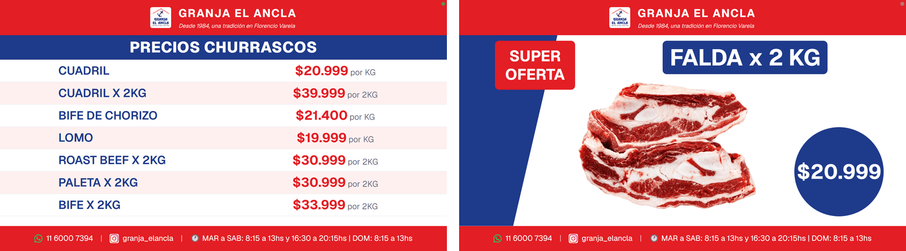

# Cartelería de precios

Cartelería digital para comercios de barrio: una pantalla que rota entre la lista de precios y los carteles de ofertas, corriendo 24/7 en un Fire TV colgado en el local. Un solo deploy sirve a varios comercios, cada uno en su propia URL, con su paleta, sus textos y su planilla.

**[Ver la pantalla en vivo →](https://tv-precios.vercel.app/granja-elancla)** (Granja El Ancla, el primer cliente) · **[Demo →](https://tv-precios.vercel.app/demo)** (comercio ficticio, para mostrar el producto)



<sub>Los dos modos entre los que rota la pantalla: tabla de precios (izquierda) y cartel de superoferta (derecha). Datos reales de la planilla del cliente.</sub>

---

## El problema

Granja El Ancla (Florencio Varela, desde 1984) mostraba sus precios en carteles impresos. Cada cambio de precio implicaba imprimir de nuevo, y en un rubro donde los valores se mueven seguido, los carteles quedaban desactualizados o directamente desaparecían.

El requisito real era más exigente que "hacer una landing":

- **Quien carga los precios no es técnico.** Tenía que poder actualizar desde algo que ya usa: una planilla de Google Sheets.
- **La pantalla no tiene teclado ni alguien que la atienda.** Corre en un Fire TV, sobre el navegador Silk, sin que nadie la mire durante horas. Si se cuelga, se queda colgada hasta que alguien lo note.
- **El costo tiene que ser cero.** Es un comercio de barrio: la solución no puede generar una factura mensual.

Todo lo que sigue son decisiones tomadas contra esas tres restricciones. Después del primer cliente apareció la cuarta: **el mismo deploy tiene que servir al siguiente comercio sin volver a armar nada.**

---

## Cómo funciona

```
Google Sheets del comercio (publicado como CSV)        Cloudinary (catálogo de imágenes)
        │                                                        │
        │  3 fetch en paralelo (productos · ofertas · config)     │  URL por slug, transformada al vuelo
        ▼                                                        ▼
Server Component  app/[tenant]/page.tsx  →  getPantallaData(tenant)
        │
        │  props del primer render (SSR)
        ▼
Client Component  PantallaRotativa.tsx
        │
        ├── templates/tabla/Clasica.tsx      (lista de precios)
        └── templates/cartel/<plantilla>.tsx (cartel de oferta, elegible por oferta desde la planilla)

Service Worker  ──  watchdog anti-freeze + cache network-first (incluye Cloudinary)
```

El dueño del negocio agrega una fila en la planilla y la oferta aparece en pantalla en la próxima recarga. No toca código, no entra a un panel, no hay deploy.

La planilla no trae solo datos: una pestaña `configuracion` controla el comportamiento de la pantalla — segundos de cartel, segundos de tabla, horarios de atenuado, horarios de atención, WhatsApp e Instagram del local. Cambiar el ritmo de la rotación es editar una celda.

Cada comercio vive en `/<slug>` (`/granja-elancla`). Su configuración —nombre, paleta, textos, GIDs de la planilla— está en `tenants/<slug>.ts`. La URL de su CSV, que da acceso a toda la planilla, está en una variable de entorno y no en el repo.

---

## Decisiones técnicas

Las que más definieron el proyecto. Cada una está documentada con su alternativa descartada en [`docs/decisiones.md`](docs/decisiones.md) y el [`CHANGELOG.md`](CHANGELOG.md).

### 1. Watchdog en el Service Worker, no en el main thread

Un kiosko que corre días enteros en hardware limitado termina congelándose: el main thread se muere y la pantalla queda con datos viejos, sin que nadie se entere.

La primera versión detectaba el freeze desde el propio main thread. No servía: **cualquier mecanismo en el main thread es inútil si el thread está muerto.**

La solución fue mover el watchdog al Service Worker, que corre en otro thread. Si deja de recibir señales de vida de la página, fuerza la recarga desde afuera. A eso se suma un reload preventivo cada 10 minutos que trae precios frescos y limpia memoria y listeners acumulados.

### 2. Polling eliminado: −99,4% de requests

La versión original consultaba Sheets periódicamente: **~4.320 requests por día**. Reemplazar el polling por recargas programadas lo bajó a **~25 requests diarios**, sin perder frescura de datos para el caso de uso real (los precios cambian algunas veces por día, no cada 20 segundos).

### 3. Imágenes en Cloudinary, con un catálogo universal

Las fotos de producto vivieron primero en el repo, con un pipeline propio de compresión (`sharp` en `prebuild`, un hook `pre-commit` y un workflow de GitHub Actions). Funcionaba, pero eran cuatro mecanismos para cuidar archivos de un solo cliente, y no escalaba a varios comercios subiendo imágenes.

Hoy todas las imágenes están en Cloudinary, en un **catálogo con nomenclatura universal** (`asado-de-tira`, `pollo-entero`) compartido por todos los clientes. La app arma la URL con `f_auto,q_auto,w_1200` y Cloudinary entrega WebP/AVIF al ancho justo — mejor que lo que hacía el pipeline, sin código propio. El repo no tiene PNGs salvo el favicon. `next/image` sigue descartado: consume cuota en la capa gratuita de Vercel.

### 4. Sin cache: el precio que ves es el precio de ahora

La pantalla usaba ISR (`revalidate = 60`) hasta que apareció la pregunta que importaba: *"si corrijo un precio y aprieto actualizar, ¿lo toma?"*. Con stale-while-revalidate, no.

Hoy corre con `export const dynamic = 'force-dynamic'` y los fetch en `cache: 'no-store'` con parámetro anti-cache. Cada recarga trae precios frescos.

**Si Google falla:** el servidor informa qué parte falló y cada TV muestra
su **último dato bueno, hasta 2 horas**, guardado en el navegador de la
propia TV (punto de estado ámbar mientras tanto). Pasadas las 2 horas sin
respuesta, vuelve al empty state. Acota la decisión original de sesión 19
("mostrar un precio viejo es peor que no mostrar nada"). Ver
`docs/decisiones.md`.

### 5. Multitenant por path, sin SaaS

Para el segundo cliente había tres caminos: un deploy por comercio, un SaaS con registro y panel, o un solo deploy con N comercios por path. Se eligió el tercero: `carteleria.vercel.app/<slug>`, un archivo tipado por comercio en `tenants/`, y las URLs de las planillas en variables de entorno. Sin auth, sin base de datos, sin panel. El alta de un cliente es un archivo, una variable y un logo.

Los diseños son un **catálogo de plantillas**: hoy una tabla y un cartel, sin colores fijos (todo entra por CSS variables desde la paleta del comercio). Cada oferta puede elegir su plantilla de cartel desde un desplegable en la planilla; si no elige, usa la default del comercio.

---

## Stack

| | |
|---|---|
| Framework | Next.js 16 (App Router, Server Components) |
| UI | React 19, Tailwind CSS 4 |
| Lenguaje | TypeScript |
| Datos | Google Sheets publicado como CSV, una planilla por comercio |
| Imágenes | Cloudinary (catálogo universal, transformaciones por URL) |
| Offline / resiliencia | Service Worker (network-first + watchdog), PWA por comercio |
| Tests | `node --test` (sin dependencias) |
| CI | GitHub Actions: tipos + lint + tests + build en cada push |
| Deploy | Vercel |

---

## Estructura

```
app/
  page.tsx           "/" renderiza el comercio DEFAULT_TENANT
  [tenant]/          pantalla, rutas de dev, manifest PWA y error/loading por comercio
  api/[tenant]/      /api/<slug>/productos | ofertas | config
tenants/             un archivo por comercio + registro
templates/           catálogo de diseños: tabla/ y cartel/
components/          PantallaRotativa (rotación, reload, watchdog), Header, Footer, overlays
lib/                 lectura y parseo de los CSV, URLs de Cloudinary, helpers del alta; todo testeado
scripts/             `npm run alta`: alta de cliente desde la terminal
types/               tipos compartidos (Oferta, Tenant, …)
docs/                bitácora de implementación, decisiones técnicas, specs, planes y el pitch de venta
.github/workflows/   CI
```

---

## Desarrollo local

```bash
npm install
cp .env.local.example .env.local   # completar cloud name y la URL del CSV
npm run dev
```

Variables de entorno (ver [`.env.local.example`](.env.local.example)):

| Variable | Para qué |
|---|---|
| `DEFAULT_TENANT` | Slug del comercio que se sirve en `/` |
| `NEXT_PUBLIC_DEFAULT_TENANT` | Mismo valor, para el error boundary de `/` |
| `NEXT_PUBLIC_CLOUDINARY_CLOUD_NAME` | Cloud name de Cloudinary |
| `NEXT_PUBLIC_CLOUDINARY_CATALOGO` | Carpeta base del catálogo (`catalogo-comun`, plana; el rubro va como tag) |
| `TENANT_<SLUG>_CSV_URL` | Una por comercio: URL del CSV publicado de su planilla |
| `ACTIVACION_SECRET` | Firma cookies de las teles y de la sesión del panel |
| `SUPABASE_URL` / `SUPABASE_SERVICE_ROLE_KEY` | Estado de teles y cobros (solo servidor) |
| `ADMIN_PASSWORD` | Contraseña del panel `/admin` (Secret, Production) |
| `GOOGLE_OAUTH_CLIENT_ID` / `GOOGLE_OAUTH_CLIENT_SECRET` / `GOOGLE_OAUTH_REFRESH_TOKEN` | Solo scripts locales (`alta-express`, `google-auth`): OAuth de Drive + Sheets |
| `GOOGLE_TEMPLATE_SHEET_ID` | Solo `alta-express` (local): planilla modelo a copiar |

Scripts:

```bash
npm run dev     # desarrollo
npm run build   # build de producción
npm test        # node --test sobre lib/ y tenants/
npm run lint
npm run alta    # alta de un cliente (ver abajo)
npm run alta-express -- cliente.json   # atajo: planilla + config + logo + tenant + env + Supabase
npm run google-auth                    # OAuth de Google, una sola vez
```

Rutas de desarrollo: `/<slug>/vistaLista?index=N` y `/<slug>/vistaCartel?index=N` fijan la pantalla en un modo sin rotación.

---

## Activación de una tele

> Recorrido completo de un cliente nuevo (planilla, alta, cuenta de Amazon,
> Fire TV, Fully, local): [docs/manual-nuevo-cliente.md](docs/manual-nuevo-cliente.md).

1. Start URL definitiva del Fire TV: `https://tv-precios.vercel.app/<slug>`.
   Mientras la tele no esté activada muestra "Pantalla no habilitada" con un
   **código de activación** (ej. `K7M-2QX`, vence a los 15 min).
2. En el panel `/admin` (login con `ADMIN_PASSWORD`) → **Nueva tele** → escribir
   el código y marcar los rubros. En ≤5 s la tele queda activada y recarga con
   su rubro fijo. El código se guarda con un secreto que solo conoce la tele,
   así que sin ver la pantalla no se puede activar.
3. Plan B (sin panel): `npm run activar -- <slug> [rubros] [horas]` imprime el
   id de la tele y un link largo firmado (2 h por defecto); abrirlo en el Fire
   TV deja la cookie. Un link por tele; no mandarlo por WhatsApp.
4. Estado en Supabase (proyecto `tv-precios`, tablas `comercios` y `teles`),
   operado desde el panel, sin push:
   - **Clientes**: cada tele con su rubro y badge de última conexión (verde
     < 15 min, ámbar 15-60 min, rojo > 60 min o nunca, gris apagada); switch
     por tele y **Apagar/Prender todas**; **Cambiar rubros** y **Dar de baja**
     piden la contraseña.
   - **Cobros**: `comercios.pagado_hasta` solo **avisa** en el panel ("por
     vencer" ≤3 días, "vencido"); **Guardar fecha** fija la fecha a mano; **Pagó** la corre al mismo día del mes
     siguiente. El sistema nunca corta por pago: cortar es apagar a mano.
   - **Bajas**: el cliente dado de baja ve "Pantalla no habilitada" en todas
     sus teles; **Reactivar** (un clic) lo devuelve como estaba.
   - `comercios.requiere_activacion` (sin cookie = "Pantalla no habilitada"):
     `npm run alta` lo crea en true. `teles.activa` (switch = "Pantalla
     desactivada"). La cookie de cada tele se renueva sola (`proxy.ts`).
   Si Supabase falla, se muestra igual.

Detalle en `lib/activacion.ts`, `lib/acceso.ts`, `lib/acceso-decision.ts`,
`lib/estado-tele.ts`, `lib/codigo-alta.ts`, `app/admin/`, `app/api/alta/`, `proxy.ts`
y `supabase/migrations/`.

## Alta de un cliente

Probado de punta a punta el 01/10/2026 con el comercio de muestra (`/demo`).
Lleva unos 20 minutos. Los pasos 1 a 4 son manuales; el 5 lo hace el script.
El atajo `alta-express` (más abajo) automatiza la copia de la planilla, la
configuración, el logo, el tenant, la env y la fila en Supabase.

### 1. La planilla del cliente

1. Abrir el link de copia de la planilla modelo y nombrarla "Precios \<Comercio>".
2. Cargar las 4 pestañas: `Tablas de Precios`, `Ofertas`, `Configuracion`,
   `Precios`. Si tenés los datos en archivos, es más rápido
   **Archivo → Importar → Subir → Reemplazar hoja actual**, una pestaña por vez
   (ojo: pararse en la pestaña correcta antes de importar, porque reemplaza la
   que esté a la vista). Google filtra por `.csv` en ese diálogo: si tenés
   `.tsv`, convertilos antes.
3. En `_catalogo`, pegar el `IMPORTRANGE` al catálogo maestro y apretar
   "Permitir acceso". Ocultar esa hoja.
4. **Archivo → Compartir → Publicar en la web → Todo el documento → CSV →
   Publicar.** Copiar la URL (`…/pub?output=csv`).

### 2. Verificar los slugs de imagen

Cada valor de `slug imagen` tiene que existir en Cloudinary. **No alcanza con
abrir la URL de la imagen**: por `d_placeholder` y por la caché del CDN, un slug
inexistente o borrado puede devolver 200 igual. Se verifica con la Admin API
(`npm run verificar` en el repo del catálogo).

Si un slug no existe, el cartel sale con el placeholder gris — no rompe nada,
pero se ve mal en una demo.

### 3. El logo

Subirlo a Cloudinary como `logos/<slug>`. Dos cosas que confunden:

- La **carpeta** de la Media Library (`asset_folder`) no forma parte del
  `public_id`. Mover el archivo a la carpeta `logos` no alcanza.
- El **Display name** tampoco es el `public_id`. Hay que editar el public_id
  propiamente dicho.

Verificar: `https://res.cloudinary.com/<cloud>/image/upload/logos/<slug>` tiene
que dar 200.

### 4. Secretos en `.env.local` (una sola vez, no por cliente)

`CLOUDINARY_API_KEY`, `CLOUDINARY_API_SECRET`, `VERCEL_TOKEN`,
`VERCEL_PROJECT_ID`, `SUPABASE_URL`, `SUPABASE_SERVICE_ROLE_KEY` (ver `.env.local.example`). Sin comillas, como el resto del
archivo. El token de Vercel conviene con expiración larga: con 1 día hay que
rehacerlo en cada alta.

### 5. `npm run alta`

Pregunta nombre, slug, eslogan, dos colores, badge, contactos, la URL de la
planilla y la ruta del logo (vacío si ya lo subiste). Con eso:

- lee `/pubhtml` de la planilla y **resuelve los gids solo** (busca las pestañas
  "ofertas" y "config" por nombre);
- sube el logo a Cloudinary como `logos/<slug>`;
- escribe `tenants/<slug>.ts` y lo registra en `tenants/index.ts`;
- crea `TENANT_<SLUG>_CSV_URL` en Vercel y en tu `.env.local`;
- crea la fila del cliente en `comercios` (Supabase) con `requiere_activacion`
  en true; sin las variables de Supabase avisa y hay que cargarla a mano;
- corre `npm test`.

Flags: `--force` (sobreescribir un tenant), `--sin-logo`, `--sin-vercel`,
`--sin-supabase`.
Acepta respuestas por pipe: `npm run alta < cliente.txt`.

La paleta completa se deriva de los dos colores; `tenants/<slug>.ts` queda
editable a mano.

### 6. Commit y push

**Fuera del horario de atención de los comercios que ya están en producción**:
el push redeploya para todos, y sus pantallas recargan dentro de los 10 minutos.
Son 1-2 segundos de interrupción, pero mejor evitarlos con público en el local.

Después del deploy, verificar `<dominio>/<slug>`. Si no ves el cambio en tu
navegador, **Ctrl+F5**: el CSS y el HTML viejos quedan cacheados.

### Atajo: `npm run alta-express`

Automatiza los pasos 1, 3 y 5 a partir de un JSON: copia la planilla
modelo, la comparte por link, escribe la configuracion, resuelve los gids,
sube el logo, crea el tenant, la env y la fila en Supabase. El paso 2
(verificar que los slugs de imagen existan en Cloudinary) sigue siendo manual.

```bash
cp scripts/cliente.ejemplo.json cliente.json   # editar datos
npm run alta-express -- cliente.json
```

Requisitos (una sola vez):

1. En Google Cloud, habilitar **Drive API** y **Sheets API**.
2. Crear un **ID de cliente OAuth** de tipo **App de escritorio** y pegar
   `GOOGLE_OAUTH_CLIENT_ID` / `GOOGLE_OAUTH_CLIENT_SECRET` en `.env.local`.
3. Correr `npm run google-auth`: abre el navegador, autorizás Drive + Sheets
   y guarda `GOOGLE_OAUTH_REFRESH_TOKEN` en `.env.local`.
4. Poner el id de la planilla modelo en `GOOGLE_TEMPLATE_SHEET_ID` o en
   `planilla.templateId` del JSON.

Se usa OAuth (no service account) porque una service account no tiene cuota de
Drive y no puede ser dueña de la copia. Si la app de OAuth queda en modo
**Testing**, Google vence el refresh token a los 7 días: se vuelve a correr
`npm run google-auth`.

El CSV se arma con `/export?format=csv&gid=`, asi que no hace falta
"Publicar en la web": alcanza con que la copia quede compartida como
"Cualquiera con el link". Si en el JSON usás `planilla.sheetId` (una planilla
ya existente), el script **no cambia sus permisos**: agregá
`"compartir": true` si querés que la comparta. Tampoco escribe su
configuración salvo `"escribirConfig": true` (pisaría lo que ven sus teles). Flags: `--force`, `--sin-logo`,
`--sin-vercel`, `--sin-supabase`. Sigue faltando el commit + push y activar las
teles.

Los slugs no pueden empezar con `api`, `admin` ni `activar`: el matcher de
`proxy.ts` excluye esas rutas y la cookie de la tele no se renovaría.

Detalle técnico, decisiones y límites: [`docs/alta-express.md`](docs/alta-express.md).

La copia hereda el `IMPORTRANGE` del catálogo. Si al abrirla el catálogo no
carga, entrar a `_catalogo` y volver a dar "Permitir acceso".

### Si cambiás el slug de un tenant existente

El nombre de la variable de entorno se deriva del slug, así que cambia también
(`TENANT_<SLUG_NUEVO>_CSV_URL`). **Primero la variable en Vercel, después el
push.** Al revés, la ruta nueva queda sin datos hasta que la cargues.

Un **Redeploy** en Vercel no trae código nuevo: solo rehace el build del commit
que ya estaba desplegado. Para que salga un cambio del repo hay que pushear.

## Estado

En producción desde mayo de 2026 con Granja El Ancla, corriendo todos los días en el local. Desde octubre de 2026 el mismo deploy sirve también el comercio de muestra en `/demo`.

**Lo que falta no es técnico: es vender.** El producto está listo para ofrecer —
hay un caso real andando, un demo publicado y el alta de un cliente nuevo es un
checklist de 20 minutos. El material para ofrecerlo está en
[`docs/pitch-venta.md`](docs/pitch-venta.md).

Pendientes conocidos:

- Validar el watchdog en el navegador Silk real del Fire TV (hoy probado en Chrome de escritorio). Es lo único que nunca se probó en el hardware de verdad.
- Medir la latencia de publicación del CSV de Google (`/pub`) si el cliente nota demora al actualizar precios.
- Dominio: el genérico es `tv-precios.vercel.app` (agregado el 05/10/2026). `precios-el-ancla.vercel.app` sigue activo hasta que la TV de El Ancla pase al nuevo; no borrarlo antes.
- Limpiezas del alta del demo, opcionales: borrar `TENANT_CARNICERIA_SAN_MARTIN_CSV_URL` de Vercel y renombrar el logo a `logos/demo` (hoy sigue como `logos/carniceria-san-martin`; funciona igual).

Lo que probablemente aparezca cuando haya clientes: más plantillas de cartel
(hoy hay una sola, y es el diferencial visual más barato de construir) y fotos
de otros rubros en el catálogo, si se vende a almacén o verdulería.

---

Desarrollado por [Jonathan Castro](https://www.linkedin.com/in/johnydeev/) · [Portfolio](https://castro-jonathan-portfolio.vercel.app)
